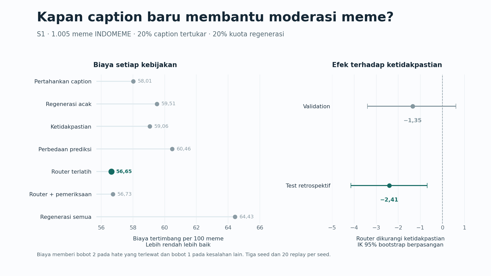

# Hasil regenerasi caption INDOMEME

Eksperimen mengukur dua hal. Pertama, pemilihan item untuk regenerasi saat kapasitas hanya 20%. Kedua, efek melatih classifier sejak awal dengan campuran caption regenerasi dan caption asli. Metrik klasifikasi adalah rata-rata Macro-F1 raw untuk hate dan inappropriate. Biaya tertimbang per 100 meme menghitung dua untuk hate yang terlewat dan satu untuk kesalahan lain. [Desain eksperimen](caption-repair-study.md)

Full training dan evaluasi selesai pada 20 November 2026 sekitar 00.56 WIB. Tiga seed S3 memakai seluruh 3.214 meme fit. Sebanyak 3.030 caption fit lolos pemeriksaan keluaran. Seed 42, 123, dan 2026 masing-masing menempuh 4, 4, dan 5 epoch sesuai aturan early stopping. Checkpoint dikunci sebelum evaluasi dan dipilih dari Macro-F1 validation pada caption asli. [Log eksperimen A100](https://node580-ai-hub.ub.ac.id/user/josephplase77/lab/tree/kelompok-7-private/cp2-caption-repair-study/pipeline.log)

## Validation dengan caption donor sintetis

Ringkasan ini mencakup 804 meme, 161 slot regenerasi per replay, 20 replay, dan tiga seed classifier. Caption yang memenuhi pemeriksaan keluaran tersedia untuk 754 meme. Router dan pemeriksaan penerimaan caption memakai prediksi out-of-fold lima lipatan yang dipisahkan berdasarkan ID meme. [Hasil validation agregat](https://node580-ai-hub.ub.ac.id/user/josephplase77/lab/tree/kelompok-7-private/cp2-caption-repair-study/validation_only_ROUTER_PRELIMINARY.json)

| Model dan kebijakan | Macro-F1 | Biaya tertimbang per 100 meme |
| --- | ---: | ---: |
| B2 mempertahankan caption | 76,33% | 55,23 |
| B2 regenerasi berdasarkan ketidakpastian | 75,05% | 58,08 |
| B2 router terlatih | 75,88% | 55,65 |
| B2 regenerasi seluruhnya | 69,52% | 70,74 |
| S1 mempertahankan caption | 74,88% | 58,39 |
| S1 regenerasi berdasarkan ketidakpastian | 74,32% | 59,32 |
| S1 router terlatih | 74,95% | 57,97 |
| S1 router dan pemeriksaan setelah regenerasi | 74,99% | 57,85 |
| S1 regenerasi seluruhnya | 70,69% | 68,21 |

Pada S1, router mengurangi estimasi biaya 1,35 per 100 meme dibanding ketidakpastian, dengan IK 95% −3,40 hingga +0,61 untuk selisih router dikurangi ketidakpastian. Efek pemeriksaan setelah regenerasi terhadap router saja adalah −0,12 dengan IK −0,61 hingga +0,33. Pada B2, router mengalahkan ketidakpastian pada validation dalam biaya tertimbang (−2,44 dengan IK −4,69 hingga −0,20) dan biaya terbaik tetap diperoleh dengan mempertahankan caption. Semua interval eksploratif dan mengondisikan pada seed dan replay yang ditentukan.

## Test retrospektif dan kuota regenerasi 20%

Pada 1.005 meme test, 948 caption baru memenuhi pemeriksaan keluaran. Setiap kebijakan selektif memiliki 201 slot regenerasi. Tabel memakai 20 replay dan tiga seed, dengan 20% caption ditukar memakai donor. [Ringkasan router](https://node580-ai-hub.ub.ac.id/user/josephplase77/lab/tree/kelompok-7-private/cp2-caption-repair-study/router_results.json)

| Kebijakan pada S1 | Macro-F1 | Biaya tertimbang per 100 meme |
| --- | ---: | ---: |
| Pertahankan caption | 75,38% | 58,01 |
| Regenerasi acak | 74,80% | 59,51 |
| Regenerasi berdasarkan ketidakpastian | 74,75% | 59,06 |
| Regenerasi berdasarkan perbedaan prediksi | 74,41% | 60,46 |
| **Router prediksi manfaat** | **75,88%** | **56,65** |
| Router dan pemeriksaan setelah regenerasi | 75,83% | 56,73 |
| Hilangkan caption pada pilihan router | 75,28% | 57,70 |
| Regenerasi seluruhnya | 72,67% | 64,43 |

Pada perbandingan utama S1, biaya router dikurangi ketidakpastian adalah **−2,41 per 100 meme** (IK 95% −4,14 hingga −0,69). Rata-rata hate yang terlewat turun dari 133,23 ke 119,40 per replay, dengan positif palsu hate naik dari 75,38 ke 89,23. Macro-F1 naik 1,14 poin dibanding ketidakpastian dan 0,50 poin dibanding mempertahankan caption. Pada B2, selisih biaya router terhadap ketidakpastian adalah −0,97 (IK −2,69 hingga +0,69). Pada S1 dengan caption asli sepanjang replay, Macro-F1 mencapai 77,23% dengan router dan 77,03% saat mempertahankan caption.

Pemeriksaan tambahan setelah menerima caption baru mengubah biaya S1 sebesar +0,09 per 100 meme (IK −0,25 hingga +0,44) terhadap router saja. Pemeriksaan mengurangi jumlah caption yang dipakai dari rata-rata 190,08 menjadi 156,83 sambil mempertahankan 201 permintaan caption. Bukti ini belum mendukung penambahan pemeriksaan sebagai tahap default. [Ringkasan pemeriksaan](https://node580-ai-hub.ub.ac.id/user/josephplase77/lab/tree/kelompok-7-private/cp2-caption-repair-study/confirmation_results.json)

## Audit topik dan OCR

Pada 948 pasangan test yang memiliki caption baru, median panjang keduanya 18 kata unik. Rata-rata bagian kosakata caption yang juga muncul di OCR naik dari 12,30% untuk caption lama ke 35,02% untuk caption baru. Keduanya mengukur kemiripan kosakata. Ketepatan fakta dan makna tersirat membutuhkan penilaian manusia.

Jika semua caption baru yang tersedia digunakan pada S1, biaya naik 10,32 per 100 meme dibanding caption asli dan turun 8,69 dibanding kondisi semua caption tertukar. Dibanding caption asli, kenaikan tertinggi di antara topik yang dianalisis terjadi pada politik (+30,75, 142 meme) dan individu (+29,85, 134 meme). Pada kelompok sosial, efek terhadap caption tertukar adalah −12,74 per 100 meme (560 meme). Topik dapat bertumpang tindih. Angka ini deskriptif dan membantu memilih kasus untuk audit manusia. [Ringkasan audit caption](https://node580-ai-hub.ub.ac.id/user/josephplase77/lab/tree/kelompok-7-private/cp2-caption-repair-study/caption_audit.json)

## Efek full training S3

| Kondisi pada 1.005 meme test | S1 | S3 | Selisih poin Macro-F1 | IK 95% |
| --- | ---: | ---: | ---: | ---: |
| Caption asli | 77,03% | 75,96% | −1,07 | −2,04 hingga −0,08 |
| Caption dihapus | 73,19% | 73,44% | +0,25 | −0,63 hingga +1,15 |
| Caption donor sintetis | 68,94% | 72,08% | +3,14 | +1,93 hingga +4,35 |
| Caption regenerasi Qwen | 72,65% | 74,07% | +1,42 | +0,25 hingga +2,63 |

Pada kondisi regenerasi, ketiga seed S3 mengungguli seed S1 yang dipasangkan di validation dan test. Efek rerata validation adalah +2,34 poin (IK +0,93 hingga +3,74), dan efek test +1,42 poin. Pada kondisi caption asli, ketiga seed S3 turun di test. Caption yang gagal dibuat menggunakan caption asli pada keduanya. [Ringkasan classifier berpasangan](https://node580-ai-hub.ub.ac.id/user/josephplase77/lab/tree/kelompok-7-private/cp2-caption-repair-study/classifier_results.json)

Pada jalur selektif, memakai S3 sebagai pengganti S1 setelah regenerasi mengubah biaya test sebesar +0,43 per 100 meme (IK −0,62 hingga +1,49) pada item dan kuota yang sama. Macro-F1 berubah dari 75,88% ke 75,62%. Untuk simulasi moderasi berkuota ini, hasil mendukung mempertahankan S1 sebagai classifier utama. S3 menunjukkan keuntungan saat seluruh dataset diuji di bawah perubahan sumber caption. [Ringkasan jalur regenerasi S3](https://node580-ai-hub.ub.ac.id/user/josephplase77/lab/tree/kelompok-7-private/cp2-caption-repair-study/specialist_results.json)

## Narasi presentasi

Uji lanjutan melengkapi hasil kuota 20%. Router awal mempertahankan biaya hampir sama pada kuota 10% dengan 101 permintaan dibanding 201. Router tiga aksi mengurangi jumlah permintaan di bawah batas 20%, sementara estimasi biaya kesalahannya lebih tinggi daripada router awal. [Perbandingan kuota lengkap](three-actions.md)

“Saat kapasitas regenerasi dibatasi, urutan berdasarkan perkiraan manfaat lebih berguna untuk S1 daripada urutan berdasarkan ketidakpastian pada replay test INDOMEME. Kenaikan Macro-F1 terhadap mempertahankan caption sekitar setengah poin. Regenerasi massal merugikan, dan kenaikan positif palsu perlu dipertimbangkan ketika penurunan hate yang terlewat dihargai lebih tinggi. Melatih classifier dengan sebagian caption baru membantu saat sumber caption berubah dan menurunkan performa pada caption asli.”

Antrean moderator komunitas Indonesia dapat memakai skor manfaat untuk memilih item yang membutuhkan caption baru. Kuota 20% dihitung sebagai permintaan ke captioner. Router memerlukan satu prediksi tambahan tanpa caption untuk tiap item dan inferensi ulang saat caption diganti. Hasil saat ini berasal dari data INDOMEME yang sudah dipakai dalam penelitian dan gangguan donor sintetis. Uji moderator, kesalahan caption alami, dan transfer lintas domain masih memerlukan data dan anotator.
