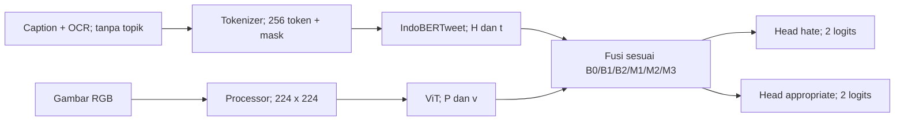
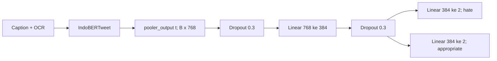
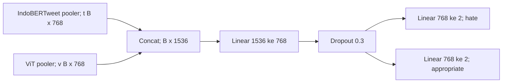
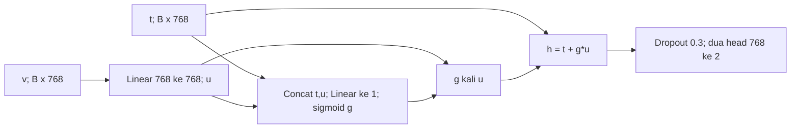
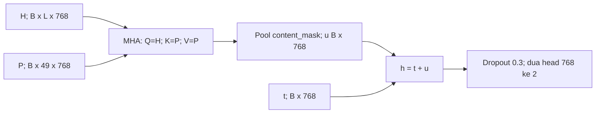
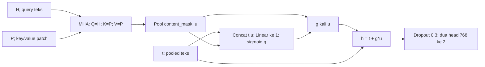
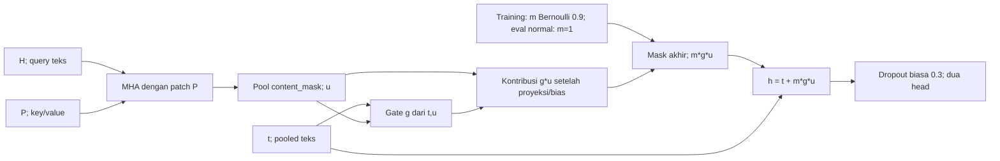

**CP2-CV01 Rancangan model dan kalibrasi INDOMEME**

Joseph (CV) · 11 November 2026 · Versi `cv-design-v1`

Saya menyiapkan rancangan ini sebagai acuan bagian CV. Isinya menjelaskan enam model yang akan dibandingkan, bentuk data yang diterima, cara mengatur kontribusi gambar, serta pemeriksaan sebelum training. Rafa akan memeriksa kecocokannya dengan input dan evaluasi NLP.

Statusnya masih draf untuk review. Implementasi model, kalibrasi GPU dan training CP2 belum dilakukan. Untuk penjelasan awal, baca [laporan sederhana](laporan-sederhana.md) atau [versi Word](laporan-sederhana.docx). Bagian 4–13 di bawah menjadi acuan saat masuk ke kode.

**1. Keputusan kerja dan batas tugas**

Saya memakai dua keluaran untuk setiap model: hate/not hate dan appropriate/inappropriate. Masing-masing mempunyai head klasifikasi sendiri, tetapi berbagi representasi input. Rancangan ini perlu disepakati bersama Rafa sebelum konfigurasi training dikunci.

| Keputusan | Nilai rancangan |
| --- | --- |
| Tujuan | Menguji kontribusi interaksi token–patch, gate dan visual dropout pada kedua tugas |
| Input utama | Caption + OCR rilis, tanpa topik anotasi manusia |
| Backbone teks | IndoBERTweet baseline, seluruh encoder di-fine-tune |
| Backbone gambar | ViT base patch32 224 baseline, seluruh encoder di-fine-tune pada model multimodal |
| Konfigurasi | B0 teks; B1 concatenation; B2 pooled gate; M1 cross-attention; M2 cross-attention + gate; M3 M2 + visual dropout |
| Tugas | `task='both'`; dua head biner berbagi representasi akhir |
| Tambahan arsitektur | Satu blok cross-attention satu arah, satu scalar gate per meme, satu mask visual per meme |
| Di luar CV01 | Training penuh, klaim hasil, classifier tiga kelas, backbone baru, retrieval, grid hyperparameter |
| Data eksternal | Pengumpulan meme baru/X dikerjakan setelah eksperimen inti selesai |

Rencana awal berfokus pada hate. Pada rancangan ini saya mempertahankan dua penilaian seperti baseline multitask. Karena itu, konfigurasi, loss, pemilihan checkpoint dan evaluator perlu memakai aturan yang sama untuk B0 sampai M3. Run hate-only dicatat terpisah bila nanti dikerjakan.

**2. Masalah dan hipotesis yang diuji**

Pada CP1, kita menyelesaikan delapan konfigurasi inti dan sepuluh hasil tugas pada satu seed. Penambahan gambar membantu penilaian ketidakpantasan, tetapi belum memperbaiki deteksi kebencian. Saya ingin memeriksa apakah cara menggabungkan teks dan gambar dapat menjelaskan perbedaan itu. B0/B1 perlu dilatih ulang tanpa topik agar inputnya setara dengan model pengembangan.

| Pertanyaan | Perbandingan yang direncanakan | Batas interpretasi |
| --- | --- | --- |
| Apakah gate membantu pada cross-attention? | M2 versus M1 | Head, jalur teks dan dropout disamakan; gate menambah parameter |
| Apakah interaksi token–patch membantu pada jalur bergate? | M2 versus B2 | Kapasitas cross-attention lebih besar; bukan kontrol jumlah parameter identik |
| Apakah visual dropout membantu? | M3 versus M2 | Arsitektur/parameter sama; strategi training berbeda |
| Apakah fusi memberi manfaat dibanding teks? | B1/B2/M1/M2/M3 versus B0 | B0 memiliki satu encoder dan bentuk projection baseline yang berbeda |
| Pada task/kondisi apa metode membantu atau merugikan? | Skor per task, robustness, rescue/hurt dan inspeksi visual | Skor gabungan tidak menggantikan pelaporan setiap task |

B1 versus B2 juga mengubah bentuk fusi/residual, bukan gate saja. B1 versus M1 tidak mengisolasi attention saja. Semua kondisi memakai setting multitask yang sama, sehingga paket ini menguji fusi dalam multitask; klaim multitask mengungguli single-task membutuhkan kontrol tambahan yang setara.

**3. Referensi baseline dan sumber yang dipakai ulang**

| Referensi repo | Dipakai untuk |
| --- | --- |
| [master_training.py](../../src/master_training.py) | Encoder, `text_values`, `MemeDataset`, `MemeClassifier`, loss, evaluator, pola checkpoint |
| [master_workflow.py](../../src/master_workflow.py) | Revisi data, `VARIANTS`, audit, split dan image loading |
| [E101 config](../../results/runs/E101/config.json) | Bentuk baseline multitask teks untuk B0 |
| [E110 config](../../results/runs/E110/config.json) | Bentuk baseline multitask concatenation untuk B1 |
| [reproduce_core.py](../../src/reproduce_core.py) | Batas runner CP1 yang mengunci source/config; tidak dipakai untuk memaksakan inovasi |
| [panduan reproduksi](../panduan_reproduksi.md) | Data, environment, artefak privat dan batas reproduksi |

Saya akan memakai ulang helper baseline yang masih sesuai dan menambahkan model pada `src/cp2_models.py`. Integrasi training berada di `src/run_cp2.py`, sedangkan evaluator dikerjakan pada jalur NLP. Sumber CP1 yang sudah dikunci tetap dipertahankan. Runner lama membuat `MemeClassifier` secara langsung, sehingga training, validation dan inferensi CP2 perlu diperiksa agar benar-benar memakai class model yang baru.

**4. Data, revisi dan kontrak batch**

Revisi awal dipatok dari config baseline:

| Komponen | Identitas |
| --- | --- |
| Dataset | `aiatums/INDOMEME`, revisi `3e0cb8cae9cd726582f69afdb122163d0eab108b` |
| Teks | `indolem/indobertweet-base-uncased`, revisi `32e28c05b47e33b6675d2670a1745c50a65e987a` |
| Gambar | `google/vit-base-patch32-224-in21k`, revisi `98cb6f7099d372694c8547bf7002289b36857dc7` |
| Jumlah data | 3.214 fit, 804 validation, 1.005 test pada manifest historis |
| Split historis | SHA-256 `4368e5767d73dfe988f9734dde59a146e125a0cda82c2783ee8eff46acab1a39`; normalisasi newline diperiksa |
| Seed | Split 42 tetap; training 42, 123, 2026 sesuai paket |

Urutan teks mengikuti `Caption+OCR`: caption, separator tokenizer, OCR; maksimum 256 token. Field kosong dilewati seperti helper baseline. NLP memvalidasi missing value agar tidak berubah menjadi string `nan`, mengaudit truncation, dan memastikan topik tidak masuk fitur. Gambar RGB diproses melalui processor pinned; tidak menerapkan normalisasi dua kali.

Notasi: `B` batch, `L=256` panjang setelah padding, `D=768`, `S=49` patch, `A=8` attention head, dimensi per head `D/A=96`.

| Field batch | Shape / tipe | Pemakai / aturan |
| --- | --- | --- |
| `input_ids` | `[B,L]`, int64 | Encoder teks; ID dari tokenizer pinned |
| `attention_mask` | `[B,L]`, 0/1 | Encoder teks; 1 berarti token aktif |
| `content_mask` | `[B,L]`, bool | Pooling cross-attention; True berarti token isi aktif |
| `pixel_values` | `[B,3,224,224]`, FP32 | B1/B2/M1/M2/M3; B0 tidak memuat encoder/gambar yang tak dipakai |
| `labels` | `[B,2]`, int64 | Kolom 0: hate; kolom 1: appropriateness, mengikuti batch baseline |
| `image_path` | B string/ID | Pairing dan audit; tidak menjadi fitur |

Validasi batas input: ukuran batch/shape konsisten, label hanya 0/1, gambar decode berhasil, nilai tensor finite, mask sesuai panjang dan tipe, serta ID tidak ganda dalam evaluasi. Kesalahan data ditolak dengan pesan jelas; gambar rusak tidak diam-diam diganti gambar hitam.

Pemetaan label: `hate: 0=not hate, 1=hate`; `appropriate: 0=appropriate, 1=inappropriate`. Nama head `appropriate` mengikuti kode lama; probabilitas kelas 1 bermakna inappropriate. Tidak ada topik, gold label, outcome model lain atau anotasi dukungan manusia sebagai input gate.

**5. Tensor encoder dan antarmuka keluaran**

| Tensor | Shape | Definisi |
| --- | --- | --- |
| `H` | `[B,L,768]` | `text.last_hidden_state` |
| `t` | `[B,768]` | `text.pooler_output`, konsisten dengan baseline |
| `V_all` | `[B,50,768]` | `image.last_hidden_state`: satu CLS + 49 patch |
| `P` | `[B,49,768]` | `V_all[:,1:,:]`; hanya patch untuk key/value |
| `v` | `[B,768]` | `image.pooler_output`, dipakai B1/B2 |
| `Q_heads` | `[B,8,L,96]` | Representasi query per attention head |
| `K_heads`, `V_heads` | `[B,8,49,96]` | Representasi key/value per head |
| `attended` | `[B,L,768]` | Output cross-attention termasuk output projection |
| `u` | `[B,768]` | Kontribusi visual pooled/proyeksi sesuai konfigurasi |
| `g` | `[B,1]` | Gate scalar, broadcast pada dimensi fitur |
| `m` | `[B,1]` | Mask visual 0/1 per meme, bukan per fitur |
| `h` | `[B,768]` | Representasi fusi B2/M1/M2/M3 |
| `logits['hate']` | `[B,2]` | Logits mentah head hate |
| `logits['appropriate']` | `[B,2]` | Logits mentah head kelayakan |

`forward` menghasilkan dictionary dua logits sesuai pola evaluator baseline. Probabilitas dihitung dengan softmax saat evaluasi; loss menerima logits mentah. Statistik gate/mask diperoleh melalui jalur inspeksi yang terpisah dari dictionary task agar evaluator tidak menganggapnya head tambahan.

**6. Diagram bersama dan matriks enam konfigurasi**



Pada B0, jalur gambar dan fusi multimodal tidak dibangun. Pada diagram, percabangan menggambarkan rancangan umum, bukan semua encoder aktif pada setiap kondisi.

`Drop_p` di bawah adalah dropout biasa PyTorch dengan `p=0,3`. `C(h)` untuk B2/M1/M2/M3 berarti satu `Drop_p(h)` yang hasilnya dipakai bersama oleh dua `Linear(768,2)` terpisah.

| ID | Representasi / classifier | Gate | Visual dropout |
| --- | --- | --- | --- |
| B0 | `t -> Drop_p -> Linear(768,384) -> Drop_p -> dua Linear(384,2)` | Tidak ada | Tidak ada |
| B1 | `[t;v] -> Linear(1536,768) -> Drop_p -> dua Linear(768,2)` | Tidak ada | Tidak ada |
| B2 | `u=Linear(768,768)(v)`; `h=t+g*u`; `C(h)` | `sigmoid(Linear(1536,1)([t;u]))` | Tidak ada |
| M1 | `u=Pool_content(MHA(H,P,P))`; `h=t+u`; `C(h)` | Kontribusi tetap 1 | Tidak ada |
| M2 | `u` seperti M1; `h=t+g*u`; `C(h)` | Sama bentuk dengan B2 | Tidak ada |
| M3 | `u/g` seperti M2; `h=t+m*g*u`; `C(h)` | Sama dengan M2 | Peluang drop 0,1 hanya training |

B0/B1 mempertahankan struktur classifier multitask historis E101/E110. B0 memiliki projection 384; B1 memiliki projection 768. Perbedaan kapasitas ini dilaporkan, bukan disamarkan sebagai classifier identik. B2/M1/M2/M3 menyamakan representasi 768 dan classifier, tanpa projection/head tambahan di antara kondisi.

**6A. B0 — baseline teks multitask**



NLP menyiapkan input/config B0; CV memastikan jalur model mengikuti E101 dengan input baru tanpa topik. Tidak memuat ViT atau memaksa `pixel_values` untuk B0. Ini baseline teks dengan caption yang tetap membawa informasi turunan gambar.

**6B. B1 — concatenation multitask**



Urutan concat adalah teks lalu gambar, seperti baseline. Tidak menambah aktivasi nonlinier atau LayerNorm pada projection karena baseline tidak memilikinya. Visual-off B1 menolkan `v` sebelum concat; bias projection tetap ada.

**6C. B2 — pooled gate dan jalur langsung teks**



Projection pooled memiliki bias. Gate dihitung dari `t` dan kontribusi `u` setelah projection. Gate satu per meme dipakai bersama kedua task; tidak menambah gate per task pada paket ini. Jalur langsung teks mempertahankan akses fitur teks dalam model yang sama, bukan menjamin prediksi B0 terlatih terpisah selalu sama.

**6D. M1 — interaksi token–patch tanpa gate**



Kontribusi visual berbobot satu. Tidak ada gate yang diam-diam dipelajari pada M1.

**6E. M2 — interaksi token–patch dengan gate**



M2 berbeda dari M1 pada scalar gate beserta parameternya. Tidak menambah blok attention, normalisasi, classifier atau loss bantu lain.

**6F. M3 — gate dan visual dropout**



M2 dan M3 memiliki jumlah parameter yang sama. Pembeda adalah mask training yang ditambahkan M3. Backbone tetap dijalankan pada rancangan utama; visual dropout tidak otomatis menghemat komputasi encoder gambar.

**7. Cross-attention: detail implementasi minimum**

Gunakan komponen platform `torch.nn.MultiheadAttention(embed_dim=768, num_heads=8, dropout=0.0, bias=True, batch_first=True)`, `add_bias_kv=False`, `add_zero_attn=False`. Arah hanya teks menuju gambar: `query=H`, `key=P`, `value=P`; output `[B,L,768]`.

Rumus per head: `softmax(Q*K_transpose/sqrt(96))*V`, dengan proyeksi Q/K/V yang dipelajari. Output projection MHA sudah mengembalikan dimensi 768. Pooling dilakukan sesudah output projection itu; tidak menambah Linear kedua setelah pooling, FFN, LayerNorm, residual query internal, atau blok Transformer lain pada versi awal. Residual teks ditambahkan sekali di luar attention melalui `h=t+...`.

Pooling token isi:

```text
content_mask = attention_mask aktif DAN input_id bukan anggota tokenizer.all_special_ids
masked_attended = attended dengan posisi content_mask=False diganti nol
u = sum(masked_attended, dim_token) / clamp(sum(content_mask, dim_token), minimum=1)
```

Jika semua token isi tidak ada, pembilang nol dan penyebut satu sehingga `u=0`. Semua proyeksi/bias MHA telah terjadi sebelum masking/pooling; jangan menambahkan bias setelah aturan nol ini. `t` tetap berasal dari encoder teks pada urutan token khusus yang valid.

`special_tokens_mask` tokenizer dapat dipakai sebagai pemeriksaan tambahan, tetapi jangan hanya mengandalkan mask token yang ditambahkan otomatis: separator yang disisipkan dalam teks juga harus dikeluarkan berdasarkan ID khusus. Ini menghindari token separator literal ikut rata-rata.

Semua 49 patch pada rancangan ini valid, sehingga `key_padding_mask=None`; tidak ada causal mask. Mask teks `[B,L]` tidak dimasukkan sebagai key padding mask `[B,49]` karena key/value berasal dari gambar. Query padding tetap diproses tetapi diabaikan oleh pooling teks. Pada MHA, boolean True pada mask key berarti posisi diabaikan, berbeda dari `content_mask=True` yang berarti dipakai.

Gunakan `need_weights=False` untuk jalur training/evaluasi metrik. Bobot perhatian hanya diambil pada inspeksi terpilih; bila diperlukan per head, shape `[B,8,L,49]` dengan averaging head dimatikan. Heatmap merupakan inspeksi asosiasi, bukan penjelasan kausal.

Kontrak ini dicek terhadap [source resmi PyTorch v2.6.0](https://github.com/pytorch/pytorch/blob/v2.6.0/torch/nn/modules/activation.py). Rancangan dimensi ViT mengikuti checkpoint baseline dan [dokumentasi Transformers v4.46.3](https://huggingface.co/docs/transformers/v4.46.3/en/model_doc/vit); validasi config dan tensor nyata tetap wajib pada smoke test.

**8. Gate, mask visual dan dropout: tiga hal berbeda**

| Komponen | Bentuk dan perilaku | Tujuan |
| --- | --- | --- |
| Gate `g` | `sigmoid(Wg*[t;u]+bg)`, `[B,1]` | Mengatur kontribusi visual secara dipelajari per meme |
| Mask visual `m` | Bernoulli keep 0,9 per meme pada M3 training; 0/1, `[B,1]` | Melatih model menghadapi jalur visual yang dinolkan |
| Dropout biasa | `p=0,3`, per fitur; perilaku standar PyTorch | Regularisasi classifier/representasi sesuai kondisi |

Gate memakai satu `Linear(1536,1)` dengan inisialisasi standar yang dicatat bersama seed; tidak memiliki ambang manual atau supervisi correctness/label. Tidak memaksa gate mendekati nol/satu selama training untuk mengejar skor tertentu. Parameter baru memakai inisialisasi standar library dengan seed yang dipatok; backbone memakai bobot pretrained pinned.

Urutan M3: `encoder -> attention + output projection -> masked pooling -> gate -> g*u -> mask visual -> residual teks -> dropout biasa -> dua head`. `m=0` harus menghasilkan kontribusi tepat nol walaupun modul visual memiliki bias. Tidak memakai `nn.Dropout(p=0,1)` secara langsung untuk visual dropout karena dropout standar memakai inverted scaling; mask visual di sini tidak dibagi 0,9.

| Mode | B0 | B1 | B2/M1/M2 | M3 |
| --- | --- | --- | --- | --- |
| Training normal | Tanpa ViT | Fusi normal | Visual aktif | Mask acak per meme; peluang nol 0,1 |
| Eval normal | Tanpa ViT | Fusi normal | Visual aktif | Mask tetap satu |
| Eval tanpa ViT | Sama dengan normal | `v=0` sebelum concat | Kontribusi visual akhir nol | Mask tetap nol |
| Uji teknis kontribusi nol | Tidak relevan | Uji lokasi zero fitur | Paksa mask kontribusi nol | Paksa mask nol |

Mask eksplisit untuk uji teknis tidak menjadi fitur yang dipelajari dan tidak mengganti distribusi training utama. Untuk M1, kontribusi berbobot satu saat normal; mask nol hanya kondisi robustness/pemeriksaan. Untuk B2/M2, mask nol juga hanya kondisi yang dinyatakan, bukan visual dropout tersembunyi saat training.

Pada cabang residual, mask nol memberi `h=t` dari model yang sama sebelum dropout/classifier. Ini bukan persamaan logits dengan B0, karena encoder, projection/head dan hasil fine-tuning berbeda. Pada loss utama, mask nol meniadakan gradien kontribusi visual; optimizer state/weight decay dapat tetap memiliki efek tersendiri, sehingga uji gradien dibedakan dari klaim seluruh bobot tidak berubah setelah optimizer step.

Caption tetap aktif saat ViT dimatikan. Pengujian tersebut menghilangkan jalur visual langsung, bukan seluruh informasi asal gambar. Input tanpa OCR juga masih dapat memiliki tulisan pada gambar; interpretasi kondisi harus sesuai sumber yang benar-benar hilang.

**9. Dua task, loss dan pemilihan checkpoint**

```text
L_hate = CE(logits['hate'], labels[:,0])
L_appropriateness = CE(logits['appropriate'], labels[:,1])
L_total = 0.5 * L_hate + 0.5 * L_appropriateness
```

Gunakan cross-entropy biasa tanpa bobot kelas tambahan pada versi awal. Label map dan kedua loss dicatat; tidak mengganti loss biner tunggal atau mengubahnya menjadi tiga kelas. CE menerima logits, bukan softmax yang sudah diaplikasikan.

Usulan keputusan validation untuk versi ini: `selection_score = 0.5*(MacroF1_hate_raw + MacroF1_appropriate_raw)`. Nilai raw dipakai agar kualitas model dua head tidak tersamarkan aturan koreksi. Ini berbeda dari pemilihan constrained pada config multitask historis, sehingga B0/B1 baru dilatih dan dipilih ulang dengan policy yang sama. Reviewer NLP perlu mengunci policy ini dalam protokol sebelum run utama.

Pada setiap run, pilih epoch dengan selection_score validation tertinggi; jika sama persis, pertahankan epoch lebih awal. Kandidat lintas-seed memakai rerata skor validation pada seed yang setara. Aturan praktis roadmap untuk selisih paling banyak 0,005 mengutamakan kandidat lebih sederhana berdasarkan parameter/waktu yang benar-benar diukur; M2 dan M3 yang setara biayanya dibedakan pula oleh tambahan strategi training.

Laporkan metrik masing-masing task, kedua loss, selection_score, confusion matrix dan pelanggaran relasi label. Pada INDOMEME semua hate berlabel inappropriate, tetapi prediksi dua head dapat tidak konsisten. Simpan raw; laporkan constrained sebagai evaluasi sekunder dengan `inappropriate_constrained=max(hate_raw,inappropriate_raw)` pada prediksi 0/1. Koreksi ini tidak diterapkan ke logits saat training dan tidak menjadi bukti model mempelajari relasi label.

Test dibuka setelah daftar checkpoint dan policy dikunci. Tidak memilih model, seed, peluang dropout atau ambang dari test. Test resmi sudah dikenal dari CP1; batas ini tetap dinyatakan.

**10. Jumlah parameter yang diharapkan dan fairness**

Hitungan berikut hanya bagian baru di luar encoder pretrained, dengan seluruh Linear/MHA memakai bias. Ini pemeriksaan aritmetika rancangan; jumlah total/trainable dari objek PyTorch aktual tetap harus dicatat saat implementasi.

| Kondisi | Parameter non-encoder yang diharapkan | Rincian |
| --- | ---: | --- |
| B0 | 296.836 | Projection 768→384 dan dua head 384→2 |
| B1 | 1.183.492 | Projection 1536→768 dan dua head 768→2 |
| B2 | 595.205 | Projection pooled 768→768, gate 1536→1, dua head |
| M1 | 2.365.444 | MHA 2.362.368 dan dua head 3.076 |
| M2 | 2.366.981 | M1 ditambah gate 1.537 |
| M3 | 2.366.981 | Sama dengan M2; mask visual tidak memiliki parameter |

Dropout/residual/pooling tidak menambah parameter. Perbedaan M2–M1 harus 1.537 pada rancangan ini, dan M3–M2 harus nol. B0 tidak memiliki encoder gambar. Perbedaan total encoder/kapasitas dilaporkan; hasil tidak dinyatakan sebagai perbandingan dengan jumlah parameter identik.

Samakan data/input, split, backbone/revisi, seed, maksimum epoch, optimizer, schedule, policy checkpoint dan lingkungan untuk pembanding terdampak. Perubahan batch/precision/pembekuan encoder akibat OOM tidak disisipkan hanya pada kandidat yang bermasalah; revisi protokol, kalibrasi ulang dan tentukan kontrol yang perlu diulang.

**11. Pemeriksaan teknis yang harus dibuat saat implementasi**

Status seluruh pemeriksaan implementasi berikut: belum dijalankan pada model CP2. Buat satu kumpulan self-check/test kecil yang menguji perilaku ini; gunakan tensor buatan untuk logika fusi dan smoke model pretrained untuk integrasi. Tidak perlu jaringan/GPU untuk setiap pemeriksaan unit.

| ID | Pemeriksaan | Cara dan kriteria lulus |
| --- | --- | --- |
| CV-T01 | Shape dan pemetaan model | B0–M3 menghasilkan dua `[B,2]`; B0 tidak membangun ViT; patch tepat 49 |
| CV-T02 | Content mask | Padding, CLS, SEP/EOS dan token khusus diabaikan, termasuk separator literal dalam teks gabungan |
| CV-T03 | Masked pooling | Menambah/mengubah posisi output yang di-mask tidak mengubah pooled output; semua mask nol menghasilkan `u=0` dan finite |
| CV-T04 | Gate | Shape `[B,1]`, nilai finite dalam [0,1]; force gate nol memberi residual lokal `h=t`, force satu memberi `h=t+u` |
| CV-T05 | Visual mask setelah bias | Pakai kontribusi dengan bias nonnol; mask nol tetap memberi kontribusi tepat nol; batch campuran 0/1 tidak menolkan seluruh batch |
| CV-T06 | Dropout train/eval | M3 memakai satu keputusan per meme; eval normal tidak acak; eval visual-off selalu nol; tidak ada scaling 1/0,9 |
| CV-T07 | Identitas M2/M3 | Dengan bobot sama, eval dan visual aktif, keluaran M2 dan M3 sama dalam toleransi; parameter M2/M3 sama |
| CV-T08 | Dua label/loss | Urutan dua kolom benar; mengubah label task kedua memengaruhi loss kedua; total sesuai bobot 0,5 |
| CV-T09 | Backward saat visual aktif | Loss finite; gradien finite dan aliran gradien ke teks, gambar, attention, gate dan dua head sesuai kondisi |
| CV-T10 | Backward saat visual nol | Periksa gradien jalur visual dari loss utama nol/tidak terhubung; gradien jalur teks/head tetap dapat mengalir |
| CV-T11 | Parameter | Hitungan non-encoder sesuai tabel; M3–M2 nol dan M2–M1 1.537 |
| CV-T12 | Evaluasi deterministik | Eval berulang pada batch sama dan config sama cocok; toleransi CPU FP32 awal `rtol=1e-5, atol=1e-6`, kernel/GPU yang berbeda dilaporkan |
| CV-T13 | Save/load | Model dimuat ulang pada config/revisi yang sama; logits eval cocok dalam toleransi; config/arsitektur berbeda ditolak |
| CV-T14 | Resume | Epoch, optimizer, scheduler, best score dan status early stopping pulih; RNG/seed epoch didokumentasikan; epoch terputus boleh diulang sesuai policy |
| CV-T15 | Integrasi runner/evaluator | Training, validation dan test memakai class CP2 yang sama; tidak diam-diam kembali ke `MemeClassifier` lama |
| CV-T16 | Integritas CP1 | `python verify_submission.py` tetap memeriksa source/bukti frozen; dokumen baru tidak mengubah checksum baseline |

Pemeriksaan padding invariance pada unit pooling dilakukan atas output attention yang dikendalikan; invariance end-to-end perlu mask encoder dan mode eval yang benar. Uji kedua encoder aktif menggunakan mask visual yang dipaksa satu, agar batch M3 yang kebetulan drop tidak menghasilkan kesimpulan salah. Gradien setiap parameter tidak harus nonnol pada setiap batch; periksa parameter representatif dan aliran yang seharusnya ada, bukan mewajibkan seluruh tensor memiliki semua elemen nonnol.

Untuk resume, jangan menjanjikan kecocokan bitwise lintas GPU/library. Simpan keadaan yang diperlukan atau tetapkan seed deterministik per epoch sesuai runner. Config tidak cocok menghasilkan run baru; tidak memuat optimizer lama secara paksa ke metode berbeda.

**12. Rencana smoke, kalibrasi dan pilot hardware**

| Tahap | Lingkup | Yang dicatat | Syarat lanjut |
| --- | --- | --- | --- |
| C0: audit konfigurasi | Source, data/model revision, split, label dan dua head | Commit/hash, parameter, environment dan config | Tidak ada field/task ambigu; sumber cocok |
| C1: unit fusi | Tensor buatan dan mask/label terkendali | Hasil CV-T02–08/11 dan failure bila ada | Aljabar dan perilaku fusi benar |
| C2: smoke integrasi | 16–32 contoh fit/validation; seluruh enam kondisi | Shape, loss, backward, eval, save/load, resume | Seluruh kondisi berjalan dengan dua head |
| C3: kalibrasi GPU | B0, B1 dan M3 sebagai profil awal; konfirmasi kondisi lain sebelum run | Peak allocated/reserved, optimizer step, simpan/muat, disk | VRAM dan storage aman pada hardware yang dipilih |
| C4: pilot metodologis | Fit 3.214/validation 804, satu epoch B1/M3; profil B0 | Waktu inisialisasi/train/validation/save, ukuran artefak | Estimasi lima epoch + overhead dapat dihitung |
| C5: keputusan paket | 6/14/18 run sesuai kapasitas nyata | Jam GPU, buffer, storage, status config final | Paket dan protokol dibekukan sebelum training utama |

Pilot C4 bukan `scope='pilot'` lama yang membatasi 128 fit/64 validation dan dua epoch. Ia memerlukan config khusus pilot satu epoch pada data internal penuh; checkpoint pilot tidak dipromosikan menjadi hasil utama. Test resmi tidak dipakai pada C1–C4.

Titik awal training: AdamW, LR `2e-5`, weight decay `0,01`, schedule linear tanpa warmup seperti baseline, grad clipping norm `1,0`, maksimum lima epoch, patience dua, FP32, batch fisik satu dan akumulasi delapan. Kedua encoder fine-tune. Nilai awal ini perlu dibuktikan muat; tidak otomatis menjadi config final karena tertulis di dokumen.

Untuk dua head, akumulasi memakai loss total yang sama. Periksa kelompok akumulasi terakhir yang lebih pendek agar normalisasi loss benar. Optimizer/scheduler step dihitung dari batch aktual; jangan mengubah effective batch hanya pada satu kondisi tanpa revisi protokol.

Catatan hardware minimum: tanggal, host/GPU UUID, model/VRAM, CUDA/PyTorch/Transformers, RAM/disk tersedia, config, panjang token/resolusi/batch/precision, total/trainable parameters, peak allocated/reserved, durasi setiap tahap, checkpoint size, log gagal dan keputusan. Sinkronkan CUDA sebelum/sesudah pengukuran waktu GPU dan reset peak memory sebelum tahap yang diukur; catat apakah cache sudah hangat. Jangan menampilkan credential/path privat pada tabel publik.

Kebijakan awal lab tetap: minimal 10 GiB VRAM bebas dan utilisasi maksimal 10%, RAM tersedia 8 GiB, disk persiapan 50 GiB dan cadangan 12 GiB; semuanya bukan reservasi atau jaminan muat. Ukur puncak checkpoint atomik, `best`, `last`, file sementara, cache dan backup. Guard historis sekitar `parameter_total*32 byte + 1 GiB` adalah batas persiapan yang harus dicocokkan dengan artefak aktual.

Seluruh penulisan server hanya di folder Kelompok 7; satu worker kelompok; proses panjang melalui tmux; tidak mengubah source saat worker aktif dan tidak menaruh token pribadi di akun bersama. Alur backup tetap server → transit laptop → Drive privat dengan tingkat verifikasi yang dicatat.

**13. Paket, kriteria berhenti dan bukti yang harus disimpan**

| Paket | Kondisi/seed | Batas bukti |
| --- | --- | --- |
| Lengkap, 18 run | Enam kondisi × tiga seed 42/123/2026 | Variasi seed semua kondisi; dua task per run |
| Ringkas, 14 run | B0/B1/M2/M3 tiga seed; B2/M1 seed 42 | Kontrol B2/M1 tetap eksploratif satu seed |
| Minimum eksploratif, 6 run | Enam kondisi seed 42 | Semua rancangan tercakup; kestabilan antar-seed belum diuji |
| Kurang dari enam | Hanya kondisi yang benar-benar selesai | Paket parsial, seluruh inovasi belum dinyatakan selesai |

Enam konfigurasi dua-head tetap enam run per seed, bukan dua belas; semua bobotnya merupakan run multitask baru. Estimasi runtime diukur ulang. Jangan menambah grid single-task untuk kedua label tanpa menghitung anggaran tersendiri.

Rumus keputusan: `sum(estimasi maksimum lima epoch + validation + save/load per run) + evaluasi akhir + backup + buffer <= jam GPU tersedia`. Selesaikan keenam kondisi seed 42 dahulu, kemudian seed tambahan B0/B1/M2/M3, baru B2/M1. Jangan memilih run yang dilanjutkan dari skor test.

Hentikan tahap gagal bila loss/gradien tidak finite, identitas source/config/split tidak cocok, checkpoint rusak, atau batas resource tidak aman. Pertahankan log/artefak; perbaiki penyebab dan kalibrasi ulang. Tidak menghapus model otomatis untuk memaksa run berikutnya muat. Hasil validation buruk tetap disimpan dan dilaporkan.

Setiap run menyimpan: config lengkap, source commit dan checksum source yang benar-benar berjalan, split/data/model revision, seed, log/history, kedua loss/metrik validation, best/last checkpoint sesuai policy, prediksi ber-ID secara privat, waktu/memori/parameter, status, serta receipt backup. Commit hasil yang dibuat kemudian berbeda dari commit sumber training.

**14. Serah terima ke NLP dan rencana review**

| Yang CV serahkan | Yang NLP periksa sebelum freeze |
| --- | --- |
| Dua head dan label map eksplisit | Nama `appropriate` tetap bermakna kelas positif inappropriate; dua kolom label konsisten |
| Kontrak `content_mask` berbasis special IDs | Separator literal, padding dan teks kosong ditangani; topik tidak ikut input |
| B0/B1 mengikuti bentuk multitask E101/E110 | Config pembanding tanpa topik, task/loss/policy sama dengan inovasi |
| Definisi enam konfigurasi dan dimensi | Kontrol M2–M1, M2–B2, M3–M2 menjawab pertanyaan yang benar |
| Mask visual tepat nol dan mode train/eval | Robustness tidak memakai gambar hitam atau mematikan caption tanpa dinyatakan |
| Raw checkpoint selection dan constrained sekunder | Evaluator/tabel menyimpan keduanya dan tidak menyembunyikan penurunan task |
| Rencana parameter/waktu/memori dan paket | Biaya dua head dan kapasitas tambahan dapat dipenuhi berdasarkan pilot |
| Kriteria CV-T01–16 | Ada pemeriksaan yang relevan serta bukti aktual pada PR implementasi |

Agenda review 30–45 menit: Joseph menjelaskan B1→M3; Rafa mengulang kontrak input/label; cocokkan mask dan output; periksa loss/selection policy; catat temuan dan keputusan. Jika scope multitask berubah, versi dokumen dan protokol diubah sebelum implementasi/run utama, tidak disisipkan hanya pada kandidat tertentu.

Reviewer checklist:

- [ ] Kedua task, label map dan raw/constrained policy dipahami serta disepakati.
- [ ] Enam diagram cocok dengan rumus, bentuk tensor dan bentuk classifier baseline.
- [ ] Mask teks tidak tertukar dengan key padding mask gambar.
- [ ] Bias/projection tidak menghidupkan kembali kontribusi yang dimatikan.
- [ ] M3 hanya berbeda dari M2 pada visual dropout training.
- [ ] Klaim perbandingan sesuai kontrol dan kapasitas yang berbeda dilaporkan.
- [ ] Kalibrasi, storage, save/load dan resume punya rencana bukti yang jelas.
- [ ] Implementasi dan pengujian yang belum dilakukan tidak ditulis sudah lulus.

**15. Status rancangan dan langkah review**

Isi rancangan CV01 sudah tersedia: diagram, enam konfigurasi, kontrak tensor, mask, gate, dropout dan rencana kalibrasi. Tahap berikutnya adalah review Rafa. Tugas ditutup setelah temuan review diselesaikan dan perubahan digabung ke main.

Status validasi dokumen saat penyusunan:

| Pemeriksaan | Status |
| --- | --- |
| Cocokkan B0/B1 dengan source dan config E101/E110 | Diperiksa dari repo baseline |
| Periksa source resmi MHA v2.6.0 dan bentuk ViT | Referensi diperiksa; tensor runtime pretrained belum diuji |
| Aljabar mask/gate/pooling dan aritmetika parameter | Diperiksa secara konseptual; receipt lokal dipisahkan dari hasil model |
| Verifier CP1 pada checkout lokal | Dijalankan ulang sebagai pemeriksaan sumber/bukti; tidak mengaudit CSV prediksi individual |
| CV-T01–16 pada implementasi CP2 | Belum dijalankan karena model CP2 belum diimplementasikan |
| Kalibrasi GPU, runtime dan training CP2 | Belum dijalankan |
| Review Rafa / NLP | Belum dilakukan |

Catatan checkout Windows: source frozen memiliki checksum byte, sehingga konversi LF→CRLF dapat membuat verifier gagal meski logika sama. Gunakan pengaturan repo-lokal yang mempertahankan byte source asli; jangan mengubah checksum frozen untuk menutupi konversi. Checkout kerja ini mempertahankan source sesuai Git blob, tanpa perubahan logika baseline.

Perubahan diajukan melalui branch `cp2/cv-design`. PR memuat rancangan ini, laporan sederhana dan panduan serah terima. Penggabungan ke main menunggu review NLP.

**16. Urutan implementasi setelah review**

Saya mulai dari B0/B1 multitask sesuai bentuk baseline, lalu B2, M1/M2 dan M3. Setiap tahap diperiksa sebelum lanjut. Rafa menyiapkan kontrak input dan evaluator secara paralel. Setelah integrasi dan pilot selesai, kita menentukan paket eksperimen dari kapasitas yang terukur.
