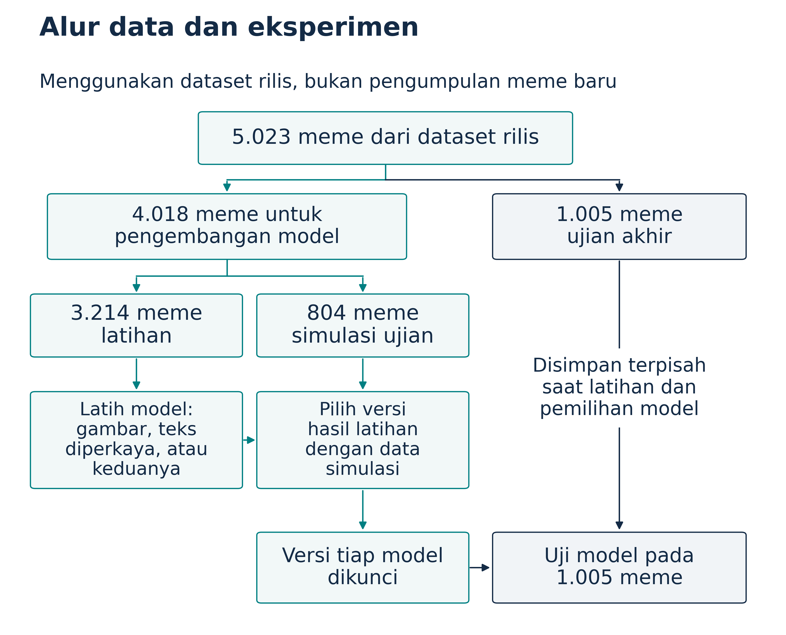
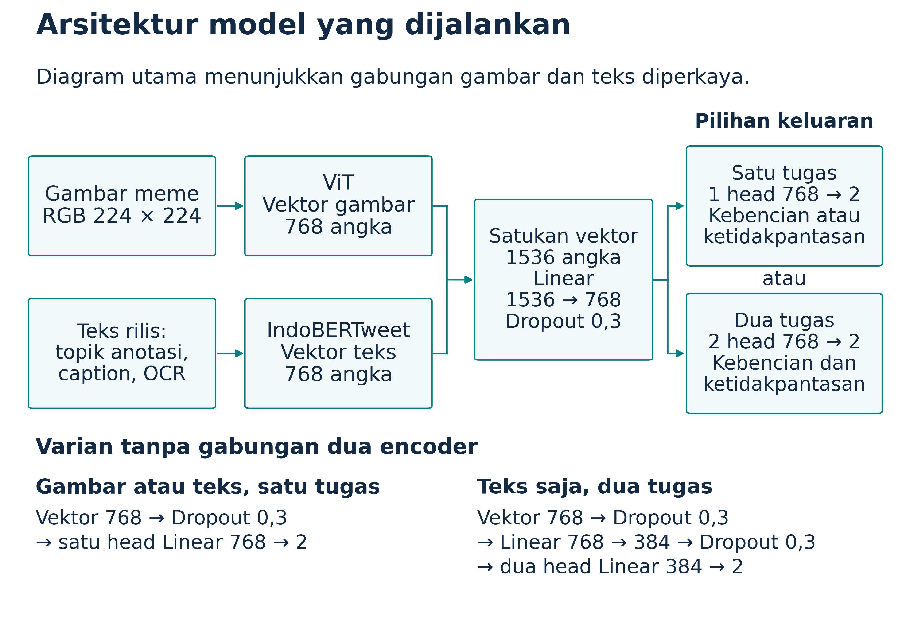
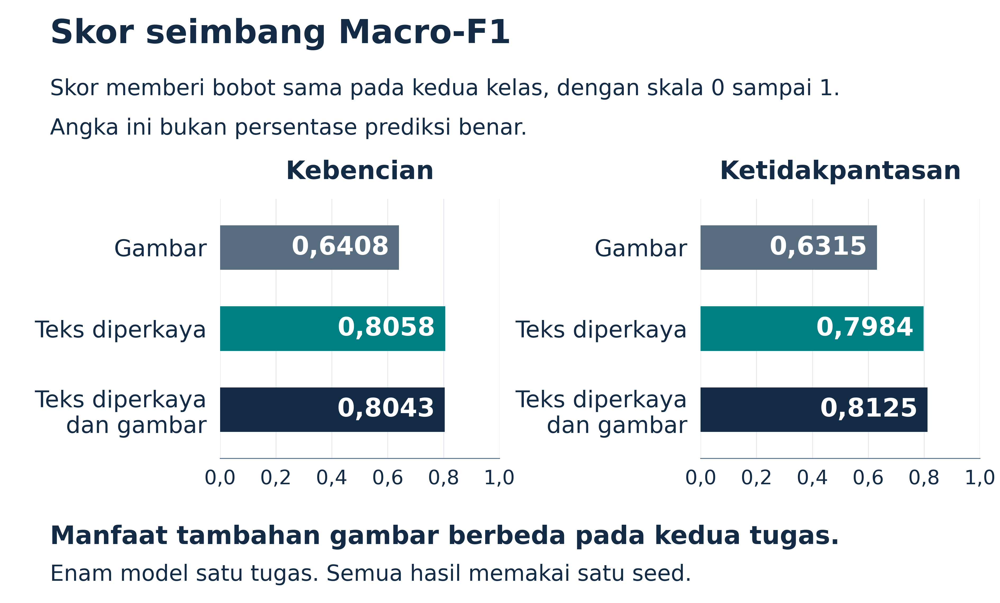
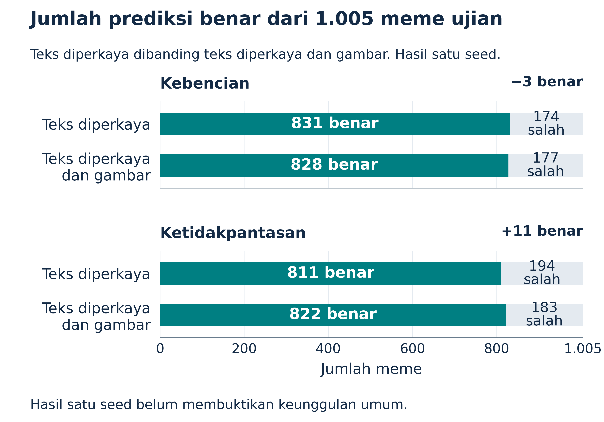

# Reproduksi Eksperimen Inti INDOMEME

Kelompok 7 · Joseph Pratama Lase dan Rafa Maritza Hanasaputri · Intelligent Systems Lab FILKOM 2026

30 Oktober 2026

## Ringkasan penelitian

Jika meme memadukan gambar dan teks, apakah tambahan gambar selalu membantu komputer menilainya?

Pertanyaan ini menjadi titik masuk penelitian kami. Dalam percobaan yang tersedia, model gabungan gambar dan teks memperoleh hasil lebih baik pada penilaian konten tidak pantas, tetapi hasil deteksi kebenciannya tidak membaik dibandingkan model teks. Temuan itu perlu dibaca bersama cara informasi diberikan kepada model: masukan teks sudah mencakup tulisan yang dibaca dari gambar, deskripsi gambar, dan topik anotasi. Perbandingan ini menilai tambahan jalur gambar langsung di atas teks yang sudah diperkaya.

Kami menyelesaikan delapan konfigurasi supervised terpilih dengan sepuluh hasil tugas pada 1.005 meme test resmi. Dibandingkan model teks, model gabungan menghasilkan tiga prediksi benar lebih sedikit pada tugas kebencian dan sebelas prediksi benar lebih banyak pada tugas ketidakpantasan. Macro-F1, ukuran yang memberi bobot setara kepada kedua kelas, memperlihatkan arah yang sama. Pendekatan multitask belum meningkatkan hasil kedua tugas secara seragam.

Laporan ini menjelaskan bahan penelitian, pemrosesan data, rumusan model, pelatihan, evaluasi, serta analisis hasilnya. Angka berasal dari konfigurasi, riwayat, dan prediksi tersimpan yang diperiksa ulang dalam notebook. [3] Temuan bersifat deskriptif pada satu seed. Paket ini merupakan reproduksi eksperimen inti terpilih, dengan perbedaan implementasi terhadap penulis yang dicatat. Seluruh grid paper, eksperimen RQ3 lengkap, dan pengembangan metode baru tidak dinyatakan selesai.

## Masalah dan pertanyaan penelitian

Meme dapat membawa pesan melalui hubungan gambar, tulisan, dan konteks sosialnya. Sebagai ilustrasi, gambar seseorang tertawa bisa menjadi candaan biasa, sementara kalimat pendampingnya dapat mengubah sasaran dan makna pesan. Ilustrasi ini menjelaskan masalah penelitian; ia bukan contoh dataset atau prediksi eksperimen.

Paper INDOMEME membahas dua penilaian: kebencian dan kelayakan konten. [1] Label kebencian menunjukkan apakah meme mengandung kebencian menurut anotasi dataset. Label kelayakan membedakan konten appropriate dan inappropriate menurut pedoman penyusunnya. Keduanya berhubungan, tetapi tidak sama. Semua meme hate dalam rilis juga inappropriate, sedangkan sebagian inappropriate tidak berlabel hate.

Untuk menjaga arti angka, nama tugas internal perlu dijelaskan. Pada tugas hate, kelas 1 berarti hate dan kelas 0 berarti not hate. Pada tugas yang di kode bernama appropriate, kelas 1 justru berarti inappropriate dan kelas 0 berarti appropriate. Dalam laporan ini, istilah ketidakpantasan merujuk pada kelas positif tugas kedua tersebut. Definisi mengikuti label dataset, tanpa menganggap penilaian itu berlaku universal di semua konteks.

Paket inti diarahkan pada pertanyaan berikut:

- Apakah data rilis, label, pembagian data, serta statistik dasarnya konsisten dengan sumber yang digunakan?
- Bagaimana perbedaan hasil ketika model menerima gambar, teks yang diperkaya, atau gabungan keduanya?
- Apakah mempelajari dua tugas secara bersamaan memberikan hasil lebih baik daripada mempelajarinya secara terpisah?

Pertanyaan pertama mencakup audit bagian RQ1. Pertanyaan modalitas mengacu pada kondisi terpilih RQ2, sedangkan multitask mengacu pada kondisi terpilih RQ4. Delapan konfigurasi dipilih dari 90 kondisi supervised dalam peta reproduksi. Pemilihan mengikuti cakupan yang disepakati sebelum kelanjutan eksperimen, bukan penambahan konfigurasi karena nilai test belum sesuai harapan.

## Dataset dan pembagian data

Kami menggunakan INDOMEME yang sudah dirilis, bukan mengumpulkan meme baru. Rilis memuat 5.023 meme dengan gambar, OCR, caption, topik, dan label. Data dari materi tambahan penerbit diperiksa silang dengan rilis Hugging Face. Revisi yang digunakan adalah 3e0cb8cae9cd726582f69afdb122163d0eab108b. Dataset card mencantumkan lisensi CC BY 4.0. [2]

Pembagian data dapat dipahami sebagai latihan, simulasi ujian, dan ujian akhir. Data latihan memperbarui bobot model. Data simulasi, disebut validation, membantu memilih versi hasil latihan pada setiap percobaan. Data ujian, disebut test, mengukur hasil versi yang telah ditetapkan. Simulasi di sini tetap memakai meme nyata dari rilis.

| Bagian data | Jumlah meme | Peran |
| --- | --- | --- |
| Train resmi | 4.018 | Sumber fit dan validation |
| Fit | 3.214 | Pembaruan bobot |
| Validation | 804 | Pemilihan checkpoint |
| Test resmi | 1.005 | Evaluasi setelah versi tiap run ditetapkan |

Fit dan validation memakai fold pertama StratifiedGroupKFold dengan lima fold, shuffle, seed 42, dan stratifikasi label gabungan. Tiga pasang gambar identik di train dikelompokkan agar tidak terpisah antara fit dan validation. Delapan konfigurasi inti memakai ID fit dan validation yang sama. Test resmi tidak diperkecil atau dipindahkan untuk menyesuaikan hasil.

*Gambar 1. Data latihan mengubah model, data simulasi memilih versi hasil latihan, dan data ujian mengukur versi yang sudah dipilih. Semua bagian menggunakan meme nyata dari rilis.*

Distribusi label juga memengaruhi cara nilai dibaca. Test memuat 347 hate dan 658 not hate. Pada kelayakan, terdapat 433 inappropriate dan 572 appropriate. Dari 433 inappropriate itu, 86 tidak berlabel hate. Komputer yang cukup baik menemukan kebencian belum tentu cukup baik mengenali seluruh ketidakpantasan.

## Audit data dan preprocessing

Audit memeriksa checksum file, keberhasilan membaca gambar, kecocokan field metadata dengan materi tambahan, serta konsistensi label. Seluruh 5.023 gambar dapat didekode. Tidak ditemukan label hate atau kelayakan yang hilang, dan OCR serta caption tersedia pada metadata yang digunakan. Topik kosong berjumlah 228, terdiri dari 179 train dan 49 test.

Nama gambar antarbagian berbeda, tetapi gambar dengan nama berbeda masih dapat identik. Audit menemukan lima kelompok gambar identik, termasuk dua kelompok yang melintasi train dan test resmi. Dua kelompok lintas split tersebut mencakup empat baris dan dua meme test. Split resmi dipertahankan untuk perbandingan dengan rilis, sehingga keterbatasan ini tetap melekat pada evaluasi.

Screening kemiripan pHash juga telah dijalankan. Hasilnya memuat 197 pasangan kandidat, dengan 73 pasangan lintas split dan 192 kandidat nonexact. Kandidat kemiripan belum otomatis berarti duplikat yang terkonfirmasi. Peninjauan manual belum selesai, dan screening dapat melewatkan perubahan tertentu pada gambar. Karena itu, pemisahan ID tidak diperlakukan sebagai bukti bahwa tidak ada kebocoran berbasis kemiripan visual.

Pemrosesan gambar membaca gambar rilis, mengubahnya menjadi RGB, lalu memakai image processor dari revisi ViT yang dipatok. Model inti menggunakan checkpoint ViT dengan masukan 224 × 224 piksel. Kami tidak menambahkan tahap pengumpulan gambar, regenerasi caption, atau ekstraksi OCR baru untuk eksperimen ini.

$$
I'_i=\operatorname{Resize}_{224\times224}(\operatorname{RGB}(I_i)),\qquad X_{i,c}=\frac{I'_{i,c}/255-0.5}{0.5}
$$

$I_i$ adalah gambar meme i, sedangkan $I'_i$ adalah hasil konversi RGB dan resize bilinear menjadi 224 × 224 piksel. Indeks c menunjukkan channel merah, hijau, atau biru. Nilai piksel dibagi 255, lalu dinormalisasi dengan mean 0,5 dan simpangan baku 0,5 per channel untuk menghasilkan tensor $X_i$. Sebagai contoh skala numerik, piksel bernilai 0 menjadi −1 dan piksel 255 menjadi 1 setelah normalisasi. Langkah ini menyesuaikan masukan dengan processor model, bukan memperbaiki makna atau isi gambar.

Jalur teks memakai varian bernama Caption+OCR+Topic. Urutan aktual kode adalah topik, caption, lalu OCR, dengan pemisah tokenizer IndoBERTweet. Field yang kosong dilewati.

$$
S_i=\operatorname{join}_{\texttt{[SEP]}}\!\left((\tau_i,C_i,O_i)_{\mathrm{nonempty}}\right),\qquad(\mathbf{x}_i,\mathbf{m}_i)=\operatorname{Tok}_{256}(S_i)
$$

$S_i$ menyatakan teks gabungan untuk meme i. Simbol $\tau_i$ adalah topik, $C_i$ adalah caption, dan $O_i$ adalah OCR. Join berarti menggabungkan bagian yang tidak kosong, sedangkan SEP adalah token pemisah tokenizer. $\mathrm{Tok}_{256}$ menghasilkan $x_i$ berupa ID token dan $m_i$ berupa attention mask, dengan padding atau truncation sampai 256 posisi. OCR merupakan tulisan hasil pembacaan gambar, caption merupakan deskripsi gambar dari rilis, dan topik merupakan anotasi pokok pembicaraan meme.

Tokenizer melakukan padding dan truncation hingga panjang 256 token. Pipeline transformer tidak memakai stemming atau penghapusan stop word. Pada audit train resmi, gabungan input IndoBERTweet mempunyai panjang maksimum 210 token dan persentil ke-95 sebesar 83 token, sehingga tidak ada input train pada kombinasi itu yang melebihi 256. Temuan tersebut tidak menjamin semua input test atau meme baru mempunyai panjang yang sama.

Caption dan OCR membuat jalur teks sudah membawa sebagian informasi gambar. Topik anotasi menambah informasi yang belum tentu tersedia pada penerapan baru. Oleh sebab itu, perbandingan teks dengan fusi mengukur manfaat tambahan encoder gambar langsung di atas informasi teks yang telah diperkaya, bukan perbandingan antara ketiadaan seluruh informasi visual dan keberadaan gambar.

## Encoder dan representasi model

Model adalah sistem yang mempelajari hubungan pola masukan dengan label. Kami menggunakan encoder yang sudah dilatih pada data lain, lalu menyesuaikannya melalui fine-tuning pada meme Indonesia. Selama fine-tuning, bobot encoder dan bagian klasifikasi diperbarui. Kinerja dinilai melalui prediksi yang dapat diperiksa, tanpa menganggap komputer memahami humor atau konteks seperti manusia.

Encoder gambar yang dipilih adalah google/vit-base-patch32-224-in21k. ViT mengolah gambar sebagai rangkaian patch dan menghasilkan representasi fitur. [4] Encoder teks adalah indolem/indobertweet-base-uncased, model yang dikembangkan untuk ranah Twitter Indonesia. [5] Kode mengambil pooler output dari kedua encoder. Revisi model dipatok dan dicatat pada config setiap run.

$$
\mathbf{h}_i^{t}=\operatorname{Pooler}_{t}(\operatorname{IndoBERTweet}(\mathbf{x}_i,\mathbf{m}_i)),\quad \mathbf{h}_i^{v}=\operatorname{Pooler}_{v}(\operatorname{ViT}(X_i)),\quad \mathbf{h}_i^{t},\mathbf{h}_i^{v}\in\mathbb{R}^{768}
$$

Simbol $h_i^t$ dan $h_i^v$ adalah fitur pooler teks dan gambar untuk meme i, masing-masing berdimensi 768. IndoBERTweet menerima $x_i$ serta $m_i$, sedangkan ViT menerima tensor gambar $X_i$. Pooler kedua encoder menerapkan dense layer dan tanh pada hidden state token pertama. Jadi, fitur yang digunakan bukan sekadar token pertama mentah atau rata-rata semua token. Vektor fitur tersebut kemudian menjadi masukan classifier.

Pada model satu modalitas dan satu tugas, representasi melewati dropout, kemudian linear classifier dua kelas. Dropout mengosongkan sebagian aktivasi secara acak saat training untuk membantu regularisasi. Pada evaluasi, dropout tidak mengacak aktivasi. Model teks dan model gambar tetap merupakan dua percobaan terpisah.

## Fusi dan pembelajaran dua tugas

Fusi menggabungkan representasi teks dan gambar melalui konkatenasi, yaitu menempatkan dua vektor secara berurutan.

$$
\mathbf{z}_i=[\mathbf{h}_i^{t};\mathbf{h}_i^{v}]\in\mathbb{R}^{1536}
$$

Simbol $z_i$ adalah vektor gabungan untuk meme i. Tanda pemisah pada rumus menunjukkan konkatenasi, bukan rata-rata atau penjumlahan kedua vektor. Karena masing-masing berdimensi 768, $z_i$ berdimensi 1.536. Representasi gabungan ini kemudian melewati linear projection dan dropout.

$$
\mathbf{s}_i^{f}=D_{0.3}(W_f\mathbf{z}_i+\mathbf{b}_f)\in\mathbb{R}^{768},\qquad \mathbf{s}_i^{tm}=D_{0.3}(W_{tm}D_{0.3}(\mathbf{h}_i^{t})+\mathbf{b}_{tm})\in\mathbb{R}^{384}
$$

Simbol $W_f$ dan $b_f$ merupakan bobot serta bias projection fusi, dengan keluaran $s_i^f$ berdimensi 768. $W_f$ memetakan 1.536 fitur menjadi 768. $D_{0.3}$ menyatakan dropout tambahan dengan probabilitas 0,3 saat training dan tidak mengacak aktivasi saat evaluasi. Cabang teks multitask memakai $W_{tm}$ dan $b_{tm}$ untuk memetakan 768 menjadi 384 fitur, dengan keluaran $s_i^{tm}$. Cabang ini mempunyai dropout sebelum dan sesudah projection. Tidak ada ReLU atau GELU pada shared projection; tanh yang disebut sebelumnya berada di dalam pooler encoder.

*Gambar 2. Jalur encoder, penggabungan fitur, projection, dan head mengikuti implementasi eksperimen. Head satu tugas dan dua tugas merupakan alternatif pada run yang berbeda. Varian teks multitask mempunyai dimensi serta urutan dropout tersendiri.*

Classifier mengubah representasi akhir menjadi dua logits untuk setiap tugas. Logits adalah skor sebelum normalisasi. Softmax mengubahnya menjadi distribusi probabilitas kelas, lalu prediksi mengambil kelas dengan nilai tertinggi.

$$
\boldsymbol{\ell}_i^{q}=W_q\mathbf{s}_i+\mathbf{b}_q,\qquad p_{i,c}^{q}=\frac{\exp(\ell_{i,c}^{q})}{\sum_{k=0}^{1}\exp(\ell_{i,k}^{q})},\qquad \hat y_i^{q}=\arg\max_{c\in\{0,1\}}p_{i,c}^{q}
$$

Simbol q menandai tugas: h untuk hate dan u untuk inappropriate. Representasi akhir $s_i$ mengikuti cabang yang digunakan, yaitu fitur setelah dropout pada single-task, $s_i^f$ pada fusi, atau $s_i^{tm}$ pada teks multitask. $W_q$ dan $b_q$ adalah parameter head. Simbol ℓ mewakili logits, sedangkan p mewakili probabilitas softmax. Indeks c dan k menunjuk kelas 0 atau 1. Label y bertopi adalah hasil argmax, yaitu kelas dengan probabilitas tertinggi.

Sebagai ilustrasi hitungan buatan, logits 0 dan 1 menghasilkan probabilitas kelas 1 sekitar 0,7311 melalui softmax. Jika label yang benar adalah kelas 1, cross-entropy untuk contoh itu sekitar 0,3133. Angka ini bukan keluaran eksperimen dan tidak menyatakan probabilitas yang sudah terkalibrasi sebagai tingkat kepastian model.

Model multitask menggunakan representasi bersama untuk dua head terpisah. Pada multimodal multitask, kedua head menerima fitur gabungan berdimensi 768. Pada teks multitask, fitur teks terlebih dahulu melewati dropout, lalu projection 768 menjadi 384, dropout berikutnya, dan dua head yang masing-masing memetakan 384 fitur ke dua kelas. Berbagi representasi memberi kesempatan dua tugas memanfaatkan pola bersama, tetapi manfaatnya tetap harus dibuktikan melalui hasil.

## Fungsi loss dan aturan hierarki

Loss mengukur seberapa tidak sesuai keluaran model dengan label latihan. Untuk satu tugas, implementasi menggunakan cross-entropy. PyTorch menerima logits dan menjalankan perhitungan yang ekuivalen dengan LogSoftmax serta negative log-likelihood. [6]

$$
\mathcal{L}_{q}=-\frac{1}{|\mathcal{B}|}\sum_{i\in\mathcal{B}}\log p_{i,y_i^{q}}^{q}
$$

Simbol $L_q$ adalah loss rata-rata untuk tugas q. B pada rumus merupakan kumpulan contoh dalam microbatch yang sedang diproses, dan jumlah anggotanya menjadi pembagi. Label $y_i^q$ adalah kelas yang benar untuk meme i pada tugas q. Probabilitas yang rendah pada label benar memberi loss lebih besar. Runner deep learning memakai cross-entropy tanpa class weight; optimisasi berusaha menurunkan loss dengan memperbarui parameter model.

Pada multitask, kedua loss digabungkan dengan bobot tetap.

$$
\mathcal{L}_{MT}=\lambda_h\mathcal{L}_{h}+(1-\lambda_h)\mathcal{L}_{u},\qquad\lambda_h=0.5
$$

Simbol $\lambda_h$ adalah bobot loss hate, sedangkan $L_h$ dan $L_u$ masing-masing menyatakan cross-entropy hate dan inappropriate. Nilai $\lambda_h$ adalah 0,5, sehingga kedua tugas mempunyai bobot yang sama. Pembobotan ini berlaku antartugas, bukan antarkelas. Nilai tersebut merupakan kandidat eksplisit yang digunakan, bukan hasil reproduksi proses tuning lambda penulis. Tidak ada pencarian lambda baru berdasarkan test.

Relasi hate mengimplikasikan inappropriate diterapkan pada tahap pengolahan prediksi setelah model menghasilkan label.

$$
\hat y_{i,u}^{con}=\max(\hat y_{i,u}^{raw},\hat y_{i,h}^{raw})
$$

Indeks u menunjukkan inappropriate dan h menunjukkan hate. Superskrip raw adalah hasil argmax setiap head, sedangkan con adalah label setelah constraint. Prediksi inappropriate constrained menjadi 1 bila head inappropriate atau head hate memprediksi 1. Prediksi raw tetap disimpan agar dampaknya dapat diperiksa. Aturan maksimum ini tidak menjadi penalti tambahan di fungsi loss pelatihan. Dua head tidak dilatih dengan loss hierarki yang tidak ada pada kode.

## Pelatihan dan pemilihan checkpoint

Seluruh run inti menggunakan seed 42, maksimum lima epoch, optimizer AdamW, learning rate 0,00002, weight decay 0,01, dropout tambahan 0,3, dan precision FP32. Scheduler menurunkan learning rate secara linear tanpa warmup. Early stopping memakai patience dua, yaitu berhenti setelah dua epoch tanpa perbaikan skor validation.

| Pengaturan | Nilai yang digunakan |
| --- | --- |
| Batch historis lokal | Fisik 2 dan akumulasi 4 |
| Batch lab | Fisik 1 dan akumulasi 8 |
| Panjang teks maksimum | 256 token |
| Pemotongan norm gradien | Maksimum 1,0 |
| Checkpoint single-task | Macro-F1 validation tertinggi |
| Checkpoint multitask | Rata-rata dua metrik validation yang ditetapkan |

Akumulasi menunda pembaruan optimizer sampai beberapa microbatch diproses, sehingga batch efektif nominal mendekati delapan pada kedua pengaturan. Kelompok terakhir dapat lebih kecil. Kode membagi loss sesuai jumlah microbatch aktual yang diakumulasi. Penyesuaian batch membantu mengatasi keterbatasan memori, tetapi tidak menjamin trajektori pembelajaran identik karena pengacakan dan operasi optimisasi dapat berbeda.

$$
B_{\mathrm{eff}}\approx bA,\qquad (b,A)=(2,4)\ \mathrm{atau}\ (1,8),\qquad B_{\mathrm{eff}}\approx8
$$

Simbol b adalah ukuran batch fisik, A adalah jumlah langkah akumulasi, dan $B_{\mathrm{eff}}$ adalah batch efektif nominal. Pengaturan historis memakai b bernilai 2 dan A bernilai 4; lab memakai b bernilai 1 dan A bernilai 8. Jendela akumulasi terakhir mengikuti jumlah microbatch yang benar-benar tersisa.

Checkpoint adalah salinan keadaan model pada tahap latihan tertentu. History dan checkpoint resume disimpan setiap akhir epoch. Prediksi serta metrik validation diperbarui bersama best checkpoint ketika skor seleksi membaik. Checkpoint terbaik ditulis secara atomik untuk mengurangi risiko kehilangan berkas saat penyimpanan.

$$
e^\star=\arg\max_{e\in\mathcal{E}}\operatorname{MacroF1}_{q,val}(e)
$$

Simbol e adalah nomor epoch, sedangkan E adalah himpunan epoch yang benar-benar dijalankan, dengan maksimum lima. Epoch terpilih e berbintang memaksimalkan Macro-F1 validation pada tugas q. Bila skor sama, kode mempertahankan checkpoint yang lebih dahulu mencapai nilai tersebut. Checkpoint tidak dipilih dari skor test.

$$
e^\star=\arg\max_{e\in\mathcal{E}}\frac{\operatorname{MacroF1}_{h,val}(e)+\operatorname{MacroF1}_{u,val}^{con}(e)}{2}
$$

Untuk multitask, h menandai hate dan u dengan superskrip con menandai inappropriate setelah constraint. Kriteria pemilihan adalah rata-rata kedua Macro-F1 validation, bukan Macro-F1 salah satu tugas. Pembagian dua pada kriteria ini juga berbeda konsep dari bobot lambda pada fungsi loss. Setelah checkpoint tiap run dipilih, run ID, konfigurasi, split, serta checksum checkpoint dikunci sebelum evaluasi test.

Empat hasil lokal terdahulu dipakai ulang. Empat kondisi berikutnya selesai pada lab setelah kalibrasi sumber daya. Kegagalan CUDA out of memory sebelumnya tetap tercatat sebagai percobaan gagal, terpisah dari run pengganti yang selesai. Jumlah epoch yang dijalankan juga dibedakan dari epoch yang dipilih: E110 menyelesaikan lima epoch, tetapi memakai checkpoint epoch tiga untuk test.

## Cara membaca metrik evaluasi

Accuracy adalah proporsi seluruh prediksi yang cocok dengan label. Nilai ini mudah dibaca, tetapi dapat terlihat cukup tinggi ketika satu kelas lebih sering muncul. Contoh nyata terdapat pada baseline mayoritas validation: 531 dari 804 prediksi benar, tetapi tidak satu pun dari 273 meme hate dikenali. Menjawab semua contoh sebagai kelas mayoritas melewatkan seluruh kelas positif.

Confusion matrix memperlihatkan empat jenis keputusan. True positive atau TP adalah kelas positif yang diprediksi positif. False positive atau FP adalah kelas negatif yang diprediksi positif. False negative atau FN adalah kelas positif yang terlewat. True negative atau TN adalah kelas negatif yang dikenali dengan benar. Untuk ketidakpantasan, kelas positif berarti inappropriate.

$$
P_c=\frac{TP_c}{TP_c+FP_c},\qquad R_c=\frac{TP_c}{TP_c+FN_c}
$$

$P_c$ atau precision menjawab seberapa tepat prediksi ketika model menyebut kelas c. $R_c$ atau recall menjawab berapa banyak anggota kelas c yang berhasil ditemukan. $TP_c$, $FP_c$, dan $FN_c$ dihitung dengan menjadikan kelas c sebagai kelas yang sedang dinilai. Bila penyebut bernilai nol, implementasi metrik memberi nilai nol, sesuai kebijakan zero_division yang digunakan.

$$
F1_c=\frac{2P_cR_c}{P_c+R_c},\qquad \operatorname{MacroF1}=\frac{F1_0+F1_1}{2}
$$

$F1_c$ menggabungkan precision $P_c$ dan recall $R_c$ untuk kelas c. Macro-F1 kemudian merata-ratakan $F1_0$ dan $F1_1$ dengan bobot setara. Jika jumlah precision dan recall nol, F1 kelas itu juga diberi nilai nol. Macro-F1 bukan harmonic mean dari macro-precision dan macro-recall. **Macro-F1 juga bukan persentase prediksi benar.** Skor 0,81 tidak berarti 81% meme dijawab benar.

$$
\operatorname{Accuracy}=\frac{1}{N}\sum_{i=1}^{N}\mathbf{1}[\hat y_i=y_i]=\frac{TN+TP}{TN+FP+FN+TP}
$$

Simbol N adalah jumlah contoh yang dievaluasi. Fungsi indikator bernilai satu bila label prediksi sama dengan label rilis, dan nol bila berbeda. Accuracy menghitung bagian prediksi benar dari seluruh N. Nilainya dapat ditulis sebagai proporsi atau dikalikan 100 untuk menjadi persentase. Laporan ini menulis accuracy tabel sebagai proporsi 0 sampai 1, terpisah dari Macro-F1.

### Contoh hitungan dari eksperimen E059

Pada tugas hate, E059 menghasilkan confusion matrix berikut. Baris menunjukkan label rilis dan kolom menunjukkan prediksi.

| Label rilis | Prediksi not hate | Prediksi hate |
| --- | --- | --- |
| Not hate | 573 | 85 |
| Hate | 92 | 255 |

Ada 255 TP, 85 FP, 92 FN, dan 573 TN. Precision hate adalah 255 dibagi 340, yaitu 0,7500. Recall hate adalah 255 dibagi 347, yaitu sekitar 0,7349. F1 hate sekitar 0,7424. Dengan cara yang sama, F1 not hate sekitar 0,8662.

$$
\begin{aligned} C&=\begin{bmatrix}573&85\\92&255\end{bmatrix},\qquad \operatorname{Accuracy}=\frac{573+255}{1005}=0.8238806\\ F1_1&=\frac{2(255)}{2(255)+85+92}=0.7423581\\ F1_0&=\frac{2(573)}{2(573)+85+92}=0.8662132\\ \operatorname{MacroF1}&=\frac{0.7423581+0.8662132}{2}\approx0.8042856\end{aligned}
$$

Rata-rata dua F1 tersebut menghasilkan Macro-F1 sekitar 0,8043. Sementara itu, jumlah benar adalah 573 ditambah 255, yaitu 828. Accuracy menjadi 828 dari 1.005, sekitar 0,8239 atau 82,39%. Perbedaan kedua angka ini menunjukkan alasan Macro-F1 dan accuracy perlu dibaca bersama.

## Hasil seluruh eksperimen inti

Enam konfigurasi single-task dan dua konfigurasi multitask menghasilkan sepuluh hasil tugas. Seluruh baris di bawah memakai 1.005 meme test resmi. Teks berarti OCR, caption, serta topik anotasi rilis. Pada ketidakpantasan multitask, angka utama memakai prediksi constrained.

| ID | Tugas | Masukan | Macro-F1 | Accuracy |
| --- | --- | --- | --- | --- |
| E005 | Hate | Gambar | 0,6408 | 0,6786 |
| E006 | Tidak pantas | Gambar | 0,6315 | 0,6408 |
| E041 | Hate | Teks diperkaya | 0,8058 | 0,8269 |
| E042 | Tidak pantas | Teks diperkaya | 0,7984 | 0,8070 |
| E059 | Hate | Teks dan gambar | 0,8043 | 0,8239 |
| E060 | Tidak pantas | Teks dan gambar | 0,8125 | 0,8179 |
| E101 | Hate | Teks multitask | 0,8043 | 0,8269 |
| E101 | Tidak pantas | Teks multitask | 0,7981 | 0,8040 |
| E110 | Hate | Fusi multitask | 0,8029 | 0,8239 |
| E110 | Tidak pantas | Fusi multitask | 0,8109 | 0,8159 |

Model gambar memberi pembanding awal dengan Macro-F1 sekitar 0,64 dan 0,63. Model teks yang diperkaya memperoleh sekitar 0,81 dan 0,80. Perbedaan ini tidak membuktikan bahwa gambar tidak penting, karena jalur teks telah menerima informasi gambar melalui OCR serta caption. Ia menunjukkan hasil dari jenis representasi dan informasi yang tersedia pada konfigurasi terpilih.

*Gambar 3. Enam model single-task membandingkan gambar, teks diperkaya, dan gabungannya pada kedua tugas. Macro-F1 memberi bobot setara kepada kedua kelas dan tidak menyatakan persentase prediksi benar.*

Dibandingkan angka paper, beberapa kondisi berada dekat, beberapa di atas, dan beberapa di bawah. E059 hate berada 1,57 poin persentase Macro-F1 di bawah referensi 0,820. E101 ketidakpantasan berada 1,69 poin di bawah referensi 0,815. E041 hate berada 0,58 poin di atas referensi 0,800. Angka itu merupakan selisih deskriptif, dengan deviasi protokol dan satu seed yang membatasi klaim reproduksi identik.

## Analisis fusi dan pertukaran kesalahan

Pertanyaan utama dapat diperiksa dengan membandingkan teks dan fusi pada tugas yang sama. Pada hate, E041 mencapai Macro-F1 0,8058 dan E059 0,8043. Fusi berada sekitar 0,0015 lebih rendah, atau 0,15 poin persentase. Pada ketidakpantasan, E042 mencapai 0,7984 dan E060 0,8125. Fusi berada sekitar 0,0141 lebih tinggi, atau 1,41 poin persentase.

*Gambar 4. Pada 1.005 meme test yang sama, perbandingan hate menghasilkan 831 versus 828 prediksi benar. Perbandingan ketidakpantasan menghasilkan 811 versus 822 prediksi benar. Angka ini mengukur jumlah benar, berbeda dari Macro-F1.*

Jumlah benar keseluruhan menyembunyikan pertukaran keputusan. Pada ketidakpantasan, E060 memperbaiki 33 kesalahan E042, tetapi 22 prediksi yang benar pada E042 menjadi salah pada E060. Selisih akhirnya sebelas jawaban benar. Pada hate, E041 benar sendiri pada 22 meme dan E059 benar sendiri pada 19 meme; keduanya sama-sama salah pada 155 meme.

Temuan ini menyediakan sasaran audit manual yang lebih konkret daripada hanya melihat satu skor. Meme yang diperbaiki fusi dapat dibandingkan dengan meme yang justru menjadi salah. Namun, notebook belum memberi anotasi penyebab semantik. Pernyataan bahwa gambar membantu karena sarkasme, OCR, atau konteks budaya masih merupakan dugaan sampai contoh diperiksa dengan kriteria yang jelas.

## Hasil multitask dan pengolahan prediksi

E101 mempelajari dua tugas dari teks, sedangkan E110 mempelajari dua tugas dari fusi. Dibandingkan single-task yang sesuai, multitask belum memperbaiki hasil secara seragam. Accuracy hate E101 sama dengan E041, tetapi Macro-F1-nya berbeda. Itu dapat terjadi ketika jumlah benar tetap, sementara distribusi kesalahan di kedua kelas berubah.

Aturan hierarki juga mempunyai dampak yang dapat ditelusuri. Pada test E101, prediksi constrained mengubah satu jawaban yang semula benar menjadi salah. Macro-F1 ketidakpantasan raw adalah 0,7990, sedangkan constrained 0,7981. Pada E110, aturan tidak mengubah prediksi test sehingga Macro-F1 raw dan constrained sama, yaitu 0,8109.

Konsistensi dengan relasi label dan peningkatan skor adalah dua sasaran yang berbeda. Aturan maksimum memastikan prediksi hate tidak disertai prediksi appropriate, tetapi perubahan itu dapat menambah FP pada tugas ketidakpantasan. Hasil ini tidak membuktikan aturan selalu merugikan. Ia menunjukkan alasan menyimpan keluaran raw dan constrained, lalu melaporkan kebijakan yang digunakan secara konsisten.

Kelompok not hate tetapi inappropriate juga layak diperhatikan. Dari 86 meme test dalam kelompok ini, E042 benar pada 48, E060 pada 51, E101 pada 47, dan E110 pada 50. Kelompok tersebut berada di luar implikasi langsung dari label hate. Perbandingan ini mengukur keputusan terhadap label rilis, tanpa menetapkan kategori isi atau penyebab kesalahannya.

## Baseline validation dan hasil historis

Sebelum model inti, empat belas baseline konvensional dijalankan pada validation 804. Baseline terdiri dari Majority serta enam varian TF-IDF dan logistic regression untuk dua tugas. TF-IDF mengubah pola kemunculan kata menjadi fitur numerik. Logistic regression mempelajari pemisah kelas dari fitur tersebut. Vectorizer dipasang hanya pada fit, dan tidak ada pencarian hyperparameter baru untuk tabel ini.

Konfigurasi baseline memakai unigram dan bigram, minimum kemunculan dokumen dua, maksimum 30.000 fitur, serta sublinear TF. Logistic regression memakai C bernilai 1, solver liblinear, maksimum 1.000 iterasi, dan class weight balanced. Pengaturan ini berbeda dari cross-entropy tanpa class weight pada runner deep learning, sehingga rincian kedua pipeline tidak boleh disamakan.

| Varian | Macro-F1 hate validation | Macro-F1 tidak pantas validation |
| --- | --- | --- |
| Majority | 0,3978 | 0,3609 |
| OCR | 0,7287 | 0,6822 |
| Caption | 0,7333 | 0,7147 |
| Caption dan OCR | 0,7551 | 0,7357 |
| Caption dan topik | 0,7805 | 0,7453 |
| OCR dan topik | 0,7649 | 0,7487 |
| Caption OCR dan topik | 0,7873 | 0,7561 |

Hasil ini merupakan pembanding tambahan pada validation, bukan skor test. Varian yang memakai topik tetap memanfaatkan anotasi rilis. Dua replay mencatat hasil yang sama, tetapi tidak dihitung sebagai 28 konfigurasi independen baru. Metrik per kelas, confusion matrix, contoh kesalahan, dan insight tiap trial tersedia pada notebook lengkap.

Riwayat supervised juga mencakup SwinV2 E001, di luar paket inti, dengan Macro-F1 hate test 0,6270. E002 menyimpan tiga epoch parsial dengan Macro-F1 validation tersimpan 0,6193 dan tidak memiliki evaluasi test. Nilai validation tersebut tidak dipromosikan menjadi hasil test. Kalibrasi satu langkah optimizer, kegagalan OOM, dan percobaan inferensi RQ3 historis juga dipisahkan dari training penuh yang selesai.

## Kandidat berdasarkan validation

Checkpoint terbaik di dalam setiap run sudah dipilih saat training. Untuk pembahasan pengumpulan, kami membandingkan skor validation per tugas pada checkpoint yang telah terpilih. Ini merupakan interpretasi atas delapan konfigurasi tetap, bukan klaim bahwa pemilihan global lintas model telah dikunci sebelum seluruh run historis. Test tidak dipakai untuk membuka pencarian model baru.

Kandidat hate adalah E059 dengan Macro-F1 validation 0,8293 dan test 0,8043. Kandidat ketidakpantasan adalah E042 dengan validation 0,7924 dan test 0,7984. E060 memperoleh test ketidakpantasan tertinggi dalam paket, tetapi validation-nya lebih rendah, yaitu 0,7849. Karena itu, pemenang skor test tidak dipertukarkan dengan kandidat berbasis validation.

Margin kandidat belum kuat untuk klaim kestabilan. E042 hanya unggul sekitar 0,01484 poin persentase validation atas E110 pada ketidakpantasan. Margin E059 atas E110 pada hate sekitar 0,16377 poin. Perbedaan kecil itu perlu diperiksa melalui rancangan lanjutan, bukan diperlakukan sebagai bukti keunggulan umum.

## Batas penelitian dan kelanjutan

Seluruh hasil inti memakai satu seed, yaitu satu pengaturan pengacakan proses pembelajaran. Hasil tersebut belum menunjukkan rentang nilai pada pengacakan lain. Kami belum melaporkan interval kepercayaan atau mengklaim signifikansi perbedaan antarmodel. Selisih yang terlihat, terutama yang kecil, dapat berubah pada pengulangan yang dirancang terpisah.

Topik anotasi memberi informasi tambahan yang belum tentu tersedia untuk meme baru. Sebelum penerapan, perlu ditentukan apakah topik disediakan manusia atau diprediksi oleh sistem lain. Hasil saat ini belum mengukur pipeline end-to-end yang menghasilkan OCR, caption, dan topik secara otomatis beserta kesalahan setiap tahapnya.

Perbandingan terhadap paper juga mempunyai deviasi yang tercatat. ViT kami memakai masukan 224 × 224 piksel, sementara bagian kode penulis memakai 384 × 384 piksel. Pembentukan validation, batch fisik dan akumulasi, early stopping, pooling, serta proses tuning lambda tidak dinyatakan identik dengan semua keputusan penulis. Duplikat lintas split dan kandidat kemiripan yang belum ditinjau ikut membatasi interpretasi hasil.

Langkah terarah berikutnya adalah audit kesalahan secara manual. Peneliti dapat memulai dari meme yang hanya benar pada salah satu model, menyusun panduan kategori, lalu menilai contoh tanpa menganggap dugaan sebagai fakta. Kategori dapat memeriksa keterbacaan tulisan, kegunaan caption, kebutuhan konteks, atau ambiguitas label. Kesepakatan penilai perlu dicatat bila lebih dari satu orang melakukan anotasi.

Sesudah audit itu, pengulangan beberapa seed, evaluasi tanpa topik anotasi, atau penanganan kemiripan gambar dapat dirancang dengan tujuan dan kriteria validation yang ditetapkan lebih dahulu. RQ3 lengkap serta metode baru memerlukan cakupan tersendiri. Paket inti tidak diperluas otomatis untuk mengejar skor test yang lebih tinggi, dan hasilnya belum membuktikan kesiapan sistem untuk keputusan moderasi nyata.

## Kesimpulan

Reproduksi inti INDOMEME menunjukkan bahwa tambahan jalur gambar langsung belum otomatis memperbaiki semua penilaian meme. Pada konfigurasi dan seed yang digunakan, fusi lebih baik untuk ketidakpantasan, sementara deteksi hate tidak membaik terhadap teks yang diperkaya. Multitask juga belum memberikan perbaikan yang seragam. OCR, caption, dan topik dalam jalur teks menjadi konteks penting bagi kesimpulan tersebut.

Delapan konfigurasi dan sepuluh hasil tugas memiliki bukti yang dapat ditelusuri melalui konfigurasi, history, prediksi, metrik, serta notebook beroutput. Pemilihan kandidat mengikuti validation dengan batas interpretasinya. Nilai utama pekerjaan ini adalah tersedianya alur eksperimen dan bukti yang dapat diperiksa, termasuk hasil yang tidak membaik dan proses yang belum selesai, sebagai dasar penelitian lanjutan yang lebih terarah.

## Istilah singkat

| Istilah | Makna dalam penelitian |
| --- | --- |
| Dataset | Kumpulan meme, informasi pendamping, dan label rilis. |
| Encoder | Bagian model yang mengubah masukan menjadi representasi fitur. |
| Fine-tuning | Menyesuaikan bobot model yang sudah dilatih sebelumnya pada tugas ini. |
| Epoch | Satu lintasan latihan terhadap data fit. |
| Validation | Data untuk memilih versi hasil latihan sebelum test tiap run. |
| Checkpoint | Salinan model pada tahap latihan tertentu. |
| Logits | Skor kelas sebelum normalisasi softmax. |
| Loss | Ukuran ketidaksesuaian prediksi dengan label selama training. |
| Fusi | Penggabungan representasi teks dan gambar. |
| Multitask | Pembelajaran beberapa tugas melalui sebagian representasi bersama. |
| Macro-F1 | Rata-rata F1 tiap kelas dengan bobot setara. |
| Seed | Pengaturan pengacakan untuk membantu penelusuran eksperimen. |

## Referensi dan bukti

[1] Pamungkas dkk. (2026). Decoding hate in memes: multimodal and multitask approaches for low-resource Indonesian social media. PeerJ Computer Science. DOI 10.7717/peerj-cs.3736. https://peerj.com/articles/cs-3736/

[2] aiatums. INDOMEME dataset card dan rilis dataset. Revisi 3e0cb8cae9cd726582f69afdb122163d0eab108b. https://huggingface.co/datasets/aiatums/INDOMEME

[3] Kelompok 7. Notebook lengkap dengan hasil analisis tersimpan, sumber implementasi, konfigurasi, dan data pendamping. https://drive.google.com/drive/folders/1c7cuGs_ij6ghZxLF21D6GZ1Hk3a8nplH

[4] Dosovitskiy dkk. An Image is Worth 16x16 Words: Transformers for Image Recognition at Scale. https://arxiv.org/abs/2010.11929

[5] Koto, Lau, dan Baldwin (2021). IndoBERTweet: A Pretrained Language Model for Indonesian Twitter with Effective Domain-Specific Vocabulary Initialization. https://aclanthology.org/2021.emnlp-main.833/

[6] PyTorch. CrossEntropyLoss. Dokumentasi resmi. https://docs.pytorch.org/docs/stable/generated/torch.nn.CrossEntropyLoss.html

Kode dan progres proyek tersedia pada repository privat Kelompok 7. https://github.com/josephp77-CyS/indomeme-kelompok-7 Akses mengikuti izin pemilik repository.
